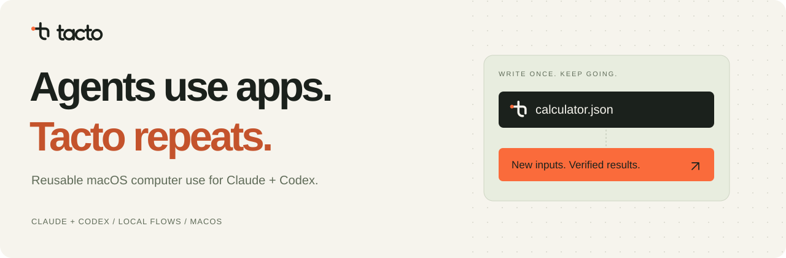
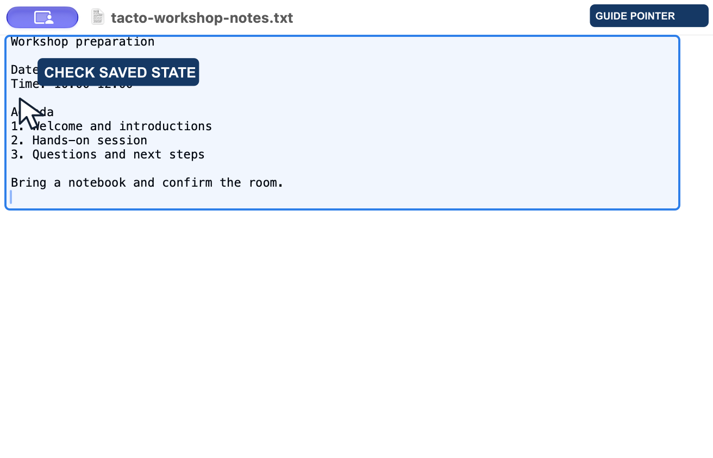
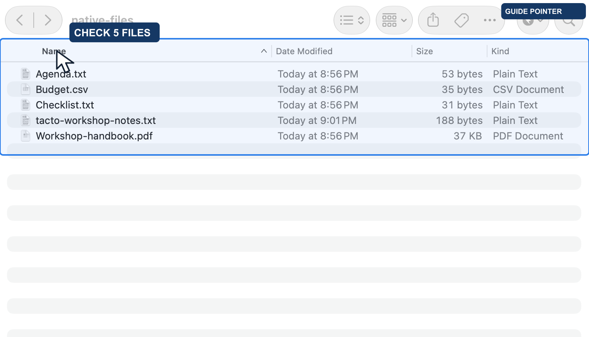
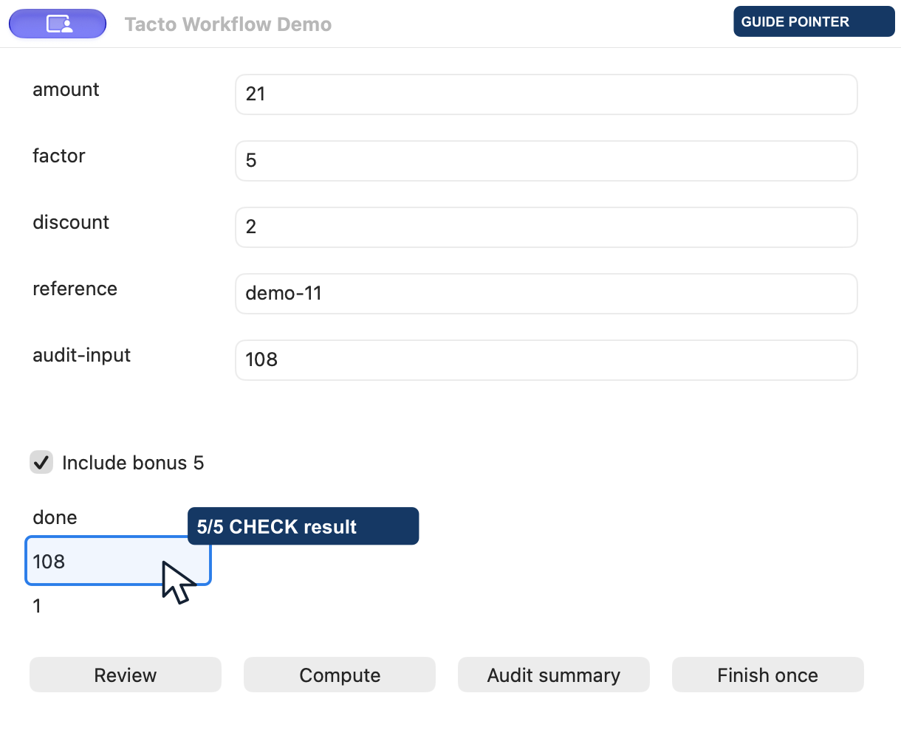

[English](README.md) · **한국어**

<div align="center">



### 에이전트의 앱 조작을 저장하고, 다음에도 실행하세요.

**Tacto는 에이전트가 브라우저와 Mac 앱을 조작하게 하는 도구입니다.**<br>
에이전트가 화면을 읽고 클릭·입력하는 작업을 Flow라는 실행 순서로 저장합니다.<br>
같은 작업은 입력값만 바꿔 재생하고, 결과를 확인하세요.

[](docs/installation.md)
[](skill/SKILL.md)
[](#getting-started)

[시작하기](#getting-started) &nbsp;·&nbsp; [작동 방식](#how-it-works) &nbsp;·&nbsp; [벤치마크](#benchmarks) &nbsp;·&nbsp; [온보딩 웹사이트](sites/tacto/README.md) &nbsp;·&nbsp; [문서](#documentation)

</div>

<br>

## 실제 앱에서 이런 일을 맡깁니다

[](sites/tacto/dist/assets/demos/browser-wikipedia.mp4)

**실제 앱·웹사이트 8개와 공개 테스트 2개, 총 10개 상황의 실행 영상**을 제공합니다.
위 GIF는 실제 실행 영상의 미리보기입니다. 클릭하면 원본 MP4를 볼 수 있습니다.
GitHub의 접근성 설정에서 애니메이션 자동재생을 끄면 정지 화면으로 보일 수 있습니다.

| 앱·사이트 | 맡긴 작업과 확인한 결과 | 실제 영상 |
| :--- | :--- | :--- |
| TextEdit | 워크숍 메모 입력 후 별도 저장 검증으로 디스크·문서 내용 일치 확인 | [약 10초](sites/tacto/dist/assets/demos/native-textedit.mp4) |
| Finder | 파일 종류 정렬 → 이름 오름차순 정렬, 파일 5개 확인 | [약 8초](sites/tacto/dist/assets/demos/native-finder.mp4) |
| Google 번역 | 영어 합성 예문 입력 → 한국어 출력 별도 확인 | [약 7초](sites/tacto/dist/assets/demos/browser-translate.mp4) |
| GitHub | 열린 버그만 필터링하고 댓글 많은 순서로 조회 | [약 9초](sites/tacto/dist/assets/demos/browser-github.mp4) |
| UnitConverters.net | 3.5 m → 11.482939633 ft, 별도 계산식과 대조 | [약 9초](sites/tacto/dist/assets/demos/browser-units.mp4) |
| Markdown Live Preview | 기존 예제 앞부분을 계획으로 수정, 제목·목록·굵은 글씨 확인 | [약 18초](sites/tacto/dist/assets/demos/browser-markdown.mp4) |
| Wikipedia | Seoul 검색 후 History 항목 도착 | [약 14초](sites/tacto/dist/assets/demos/browser-wikipedia.mp4) |
| Mac 계산기 | 같은 Flow에 다른 입력값을 넣어 15·12 확인 | [약 14초](sites/tacto/dist/assets/demos/calculator-guided.mp4) |

<a href="sites/tacto/dist/assets/demos/native-textedit.mp4"></a>
<a href="sites/tacto/dist/assets/demos/native-finder.mp4"></a>

공개 테스트 환경의 [상품 확인](sites/tacto/dist/assets/demos/browser-shopping.mp4)과
[폼 작성](sites/tacto/dist/assets/demos/browser-form.mp4)도 제공합니다. 구매·등록은 하지 않았습니다.
브라우저 사례는 **Python BrowserDriver + Flow가 여는 별도 Chromium**이며 개인 Chrome·Safari 탭 연결은 지원 범위 밖입니다.

TextEdit 입력은 저장 증거 부족으로 멈춘 뒤 별도 Save의 저장 상태 검증이 통과했습니다.
Google 번역도 입력 전송의 전달 증명과 화면의 한국어 출력 확인을 구분합니다.
Markdown은 나머지 예제가 남는 부분 수정입니다. 모든 사례가 자동으로 끝까지 완료됐다는 주장은 하지 않습니다.
영상에는 설명용 포인터와 촬영 대기가 포함되어 속도·토큰 벤치마크로 사용할 수 없습니다.

[10개 사례의 실제 조건·결과·한계](docs/tacto-everyday-examples-2026-10-15.md) ·
[온보딩 페이지](sites/tacto/README.md)

## 반복 재사용을 확인한 자체 테스트 앱

[](sites/tacto/dist/assets/demos/workflow-guided.mp4)

**실제 앱 창 촬영에 조작 위치를 보여주는 안내 포인터를 추가했습니다.** 자체 macOS 테스트 앱에서 같은 11단계 Flow를
다른 입력값으로 5회 재생했습니다. 결과 89·34·62·79·108과 작업별 완료 1회를 확인했습니다.

[반복 작업 영상 · 약 17초](sites/tacto/dist/assets/demos/workflow-guided.mp4) ·
[실제 계산기 영상 · 약 14초](sites/tacto/dist/assets/demos/calculator-guided.mp4) ·
[계산기 원본 스크린샷](sites/tacto/dist/assets/demos/calculator-result.png) ·
[촬영 조건과 한계](docs/tacto-recorded-demos-2026-10-15.md)

포인터·클릭 효과는 설명용으로 추가했으며 실제 시스템 커서 이동 기록이 아닙니다.
[반복 작업 원본](sites/tacto/dist/assets/demos/workflow-replay.mp4) · [계산기 원본](sites/tacto/dist/assets/demos/calculator.mp4)도 제공합니다.
영상은 작성된 Flow의 실행을 보여주며 자연어 작성 과정의 녹화가 아닙니다.
테스트 앱은 상용 업무 앱이 아닙니다. 정상 재생 중 모델 호출은 없지만 최초 작성 비용은 별도입니다.

## 에이전트에게 앱 조작을 맡기세요

에이전트가 앱 화면을 읽고 버튼을 누르고 내용을 입력합니다.
이처럼 사용자를 대신해 컴퓨터를 조작하는 기능을 **computer use**라고 부릅니다.
처음에는 에이전트가 앱을 관찰하고 작업 방법을 만듭니다. 그 흐름을 **Flow**로 저장하면,
다음에는 입력값을 바꿔 다시 실행할 수 있습니다. 대상을 찾고, 동작하고, 결과를 확인하는 반복은 Tacto 런타임이 맡습니다.

| 한 번 작성 | 여러 번 실행 | 필요한 순간에 개입 |
| :--- | :--- | :--- |
| Claude·Codex로 재사용할 Flow 작성 | 새 입력값으로 같은 작업 흐름 재생 | 판단이 필요한 단계에만 모델 사용 |
| 작성한 모델에 종속되지 않는 실행 형식 | 정상적인 결정적 재생은 **모델 호출 0회** | 지원되는 실패는 해당 단계만 수리 |

작성·판단·수리에는 모델 비용이 발생합니다. 자동 선택자 수리는 현재 개발 버전의 Codex provider가 지원합니다.

## 기존 검증 기록

| 맡긴 일 | 앱에서 수행한 동작 | 확인한 결과 |
| :--- | :--- | :--- |
| 텍스트 문서 작성·저장 | TextEdit에서 내용을 편집하고 저장한 파일과 문서 내용을 대조 | Tacto 1회 성공, 최종 내용 일치 |
| 여러 건의 같은 양식 처리 | 값 입력·검토·계산·완료 확인까지 11단계 재생 | 자체 테스트 앱에서 서로 다른 10건 모두 완료, 재생 중 모델 호출 0회 |
| 버튼 변경 후 이어서 실행 | 변경된 계산·검토 버튼을 해당 단계에서 수리하고 계속 실행 | 자체 테스트 앱의 한 작업에서 버튼 2개 수리 후 완료, 모델 호출 2회 |

[TextEdit 실행 기록](docs/benchmark-records.md#정확한-textedit-저장-상태의-실제-비교) ·
[반복·복구 실행 기록](docs/tacto-complex-scenarios-2026-10-14.md) ·
[사례를 보여주는 랜딩페이지](sites/tacto/README.md)

문서 저장은 단회 관측이고, 반복·복구는 개발 버전의 자체 앱에서 검증했습니다.
다른 업무 앱의 호환성·문서 형식·반복 안정성은 별도로 확인해야 합니다.
정해진 문서 작성이나 반복 양식 입력에 적용하려면, 사용하는 앱에서 한 건을 먼저 완료·검증한 뒤 작업 순서를 저장하세요.

서명된 macOS 도우미에서 [같은 창 안의 드래그](docs/native-drag.md)를 지원합니다. 슬라이더·텍스트 선택·캔버스 경로를 AppKit과 실제 TextEdit에서 확인했습니다. 앱 사이의 파일 드롭은 이 경로의 지원 범위에 포함되지 않습니다.

```sh
tacto capture <bundle-id> --helper --window 'Exact title' --output window.png
tacto drag <bundle-id> --helper --window 'Exact title' --from 20 80 --to 220 80
```

<a id="how-it-works"></a>

## Make it once. Use it again.

```text
처음     Claude / Codex → 앱 관찰 → Flow 작성·저장
다음     저장한 Flow + 새 입력값 → Tacto 실행·결과 확인
반복     같은 Flow + 다른 입력값 → Tacto 실행·결과 확인
```

보고서 입력, 여러 항목 처리, 같은 앱에서 반복하는 다단계 작업에 재사용할 수 있는 실행 단위를 만듭니다.
Tacto는 실행할 때 대상을 새 관찰에서 찾고 결과 조건을 검사합니다.

<details>
<summary>화면이 바뀌거나 완료 여부가 불확실하면?</summary>

개발 버전의 자동 수리는 지원되는 정적 선택자 실패에 대해 필요한 후보만 에이전트에 전달합니다.
확인된 checkpoint 이후부터 재개하며, 이미 완료됐을 수 있는 동작은 그대로 다시 보내지 않습니다.
모든 UI 변화나 crash를 복구하는 기능은 아닙니다. [자동 개입의 지원 범위](docs/tacto-auto-repair-2026-10-14.md)

네이티브 실행 중에는 메뉴 막대에 `● Tacto`가 표시되며 Esc로 중단할 수 있습니다.
GUI의 상시 메뉴 막대 아이콘은 **Tacto 설정**입니다. 설정 창을 다시 열 때 쓰며, 작업 중이라는 표시는 아닙니다.

</details>

<a id="getting-started"></a>

## 첫 작업 시작하기

**macOS 개발자 미리보기**입니다.
README는 한국어·영어로 제공하며, 앱 온보딩과 상세 가이드는 현재 주로 한국어입니다.

Apple Silicon용 **Tacto.app과 DMG의 Developer ID 서명·Apple 공증·Gatekeeper 검사**를 완료했습니다.
[Release 페이지](https://github.com/Open330/tacto/releases)에서 배포 상태와 첨부 파일을 확인하세요.
[Tacto 미리보기 다운로드](https://github.com/Open330/tacto/releases/tag/v0.1.0-preview.11) · Apple Silicon · macOS 27.0.1 · 개발자 미리보기(정식 안정 버전 아님).

Preview 11은 일부 권한만 허용된 상태를 정확히 표시하고, 첫 작업의 새 문서 창이 늦게 나타나면 입력을 반복하지 않고 기다립니다. Preview 9와 서명 식별자가 같습니다. Preview 8 이하에서 전환하는 경우 앱 조작은 **Tacto Helper**, 화면 기록은 **Tacto**에 다시 허용하세요.
DMG를 다운로드했다면 `Tacto.app`을 `Applications`로 드래그한 뒤 앱의 시작 안내를 따릅니다.
이 방식에는 사용자의 개발용 인증서나 소스 빌드가 필요하지 않습니다.

현재 **비공개 개발자 미리보기**입니다. 정식 출시는 새 사용자 설치·권한 복구·제한 베타의 사람 확인이 필요하며, GitHub 과거 참조·캐시 정리도 남아 있습니다.

설정 후 **첫 작업 시작**을 누르면 설치된 Claude Code·Codex를 감지해 새 CLI 대화를 엽니다. 명령 하나로 TextEdit 실행·새 문서 생성·환영 문구 입력과 확인을 처리하며, 내부 모델 호출은 없습니다. 에이전트 CLI 자체의 최초 신뢰·로그인 확인은 나타날 수 있습니다.

Tacto는 Dock 아이콘 없이 메뉴 막대에서 실행됩니다. 설정 창을 닫아도 백그라운드에 남으며, 메뉴 막대 아이콘에서 설정을 다시 열거나 종료할 수 있습니다. [Preview 7 검증](docs/release-readiness.md#2026-10-19-preview-7-release).

현재 저장소와 다운로드는 GitHub 접근 권한이 필요합니다. 빌드 Mac에서 설치·권한·Claude/Codex 연결과 같은 서명 팀의 앱 업데이트를 확인했습니다. 새 Mac 설치·다른 macOS 버전·정식 출시용 실제 작업과 베타 검증은 남아 있습니다. Windows·Intel Mac 빌드는 제공하지 않습니다.
기존 개발용 서명에서의 실제 앱 검증은 Finder·Safari 40회 성공, TextEdit 저장은 사용자가 앱을 앞으로 가져온 뒤 재시도 20/20 성공입니다.
최초 저장 실패 20회도 유지하며, 이 결과를 새 DMG의 무인 실행 성공으로 간주하지 않습니다.
[출시 검증 현황](docs/release-readiness.md) · [설치 범위와 제한](docs/installation.md)

**소스에서 빌드하려면** Python 3.11+, [uv](https://docs.astral.sh/uv/), Xcode Command Line Tools,
Apple 발급 코드 서명 인증서가 필요합니다. 런처·도우미를 같은 팀으로 서명합니다.

```sh
git clone https://github.com/Open330/tacto.git
cd tacto
uv sync
./build.sh
./skill/install.sh
~/.local/bin/tacto doctor
```

`doctor`와 앱의 ‘허용할 앱’ 안내에 따라 **Tacto Helper**의 macOS 권한을 허용한 뒤, Claude 또는 Codex에 요청하세요.

> Tacto 스킬로 계산기에서 12 × 34를 계산하고 결과를 확인해줘.<br>
> 같은 작업을 다시 쓸 수 있도록 매개변수가 있는 Flow로 저장해줘.

저장한 Flow 파일을 실행할 때는:

```sh
~/.local/bin/tacto run flow.json --helper
```

[설치·권한 안내](docs/installation.md) · [Flow 작성 가이드](docs/recipes.md) · [에이전트 스킬](skill/SKILL.md)

<details>
<summary>설치 문제와 개발 버전의 반복 실행</summary>

스킬을 찾지 못하면 에이전트 세션을 다시 열고 `./skill/install.sh --check`로 연결을 확인하세요.
Python 배포 이름은 `tacto-runtime`이고 기본 import는 `tacto`입니다.
Python wheel만으로는 서명된 macOS 런처·helper를 사용할 수 없습니다.
권한용 앱은 **Tacto Helper**(`helper/Tacto Helper.app/Contents/MacOS/TactoHelper`)이고 실행기는 `launcher/tacto`입니다. 번들 식별자와 서명 요구조건은 `ai.callabo.tacto.*`를 사용합니다.

> **Python 이름 충돌 주의.** 최상위 import 이름 `tacto`는 PyPI의 다른 패키지(촉각 센서 시뮬레이터)도 사용합니다. 이 프로젝트의 배포 이름은 `tacto-runtime`이며 별도 가상환경에 설치하세요. Tacto를 위해 `pip install tacto`를 실행하지 마세요. 두 패키지를 한 환경에 설치하면 서로의 파일을 덮어쓸 수 있습니다.
선택적 Playwright backend는 별도 Chromium 페이지를 사용합니다.

다음 batch·자동 수리 명령은 개발 checkout 기준이며 아직 기본 브랜치의 배포 기능이 아닙니다.

```sh
~/.local/bin/tacto batch template.json --helper < jobs.jsonl
~/.local/bin/tacto batch template.json --helper --auto-repair codex < jobs.jsonl
```

</details>

<a id="benchmarks"></a>

## 반복 추론을 줄이면 무엇이 달라질까요?

**개발 버전의 Tacto·Sky 비교에서 전체 입력 토큰 53.5% 감소를 관측했습니다.**
같은 요청 모델·추론 강도와 테스트 앱의 초기 상태를 맞춘 독립 새 대화 3쌍의 결과입니다.

| 지표 | Tacto | Sky |
| :--- | ---: | ---: |
| 작업 성공 | 3/3 | 3/3 |
| 전체 입력 토큰 | **201,447** | 433,312 |
| 평균 시간 | **42.10초** | 46.17초 |

작은 표본의 관측값입니다. 모든 작업에서 더 빠르다는 뜻은 아니며 한 케이스에서는 Sky가 더 빨랐습니다.
[측정 조건과 전체 결과 →](docs/tacto-matched-comparison-2026-10-14.md)

<details>
<summary>캐시·출력·복잡한 Flow 재사용 결과</summary>

2026-10-14 · Codex CLI 0.161.0 · 요청 모델 gpt-6.1-sol · medium.
최초 작성·실행·최종 응답을 포함하고 테스트 준비 시간은 제외했습니다.
실제 serving model·서버 캐시·청구비용은 미확인입니다.

- 캐시 읽기 제외 입력: Tacto 22,119 / Sky 50,592 (**56.3% 감소**).
- 출력: Tacto 1,605 / Sky 1,604.
- 시간 합계: **8.8% 감소**. 이 측정은 10회 재사용 비교가 아닙니다.
- 별도의 11단계 테스트 앱: 정상 작업 **13/13 완료**, 기대 중단 **5/5**, 한 작업에서 버튼 2개 수리.
- 해당 테스트의 정상 10회 반복은 모델 호출 **0회**. 실제 업무 앱 전체의 성공률을 대신하지 않습니다.

[복잡한 시나리오 결과](docs/tacto-complex-scenarios-2026-10-14.md)

</details>

## 먼저 흐름을 살펴보세요

[온보딩 랜딩페이지](sites/tacto/README.md)에서 재생·수리·중단 예시와 설치 안내를 제공합니다.
실제 앱이나 모델을 실행하지 않는 인터랙티브 소개입니다.

```sh
python3 sites/tacto/serve.py
```

`http://127.0.0.1:8787`에서 확인할 수 있습니다.

<a id="documentation"></a>

## 필요한 문서부터

[설치](docs/installation.md) · [Flow 작성·재생](docs/recipes.md) · [API](docs/api.md) · [지원 기능](docs/capabilities.md) · [에이전트 스킬](skill/SKILL.md)

<details>
<summary><strong>CLI 명령 찾아보기</strong></summary>

기본 브랜치에서 제공하는 명령입니다.

| 목적 | 명령 |
| :--- | :--- |
| 설치·환경 확인 | `tacto doctor` |
| 앱·화면 관찰 | `tacto apps`, `tacto observe`, `tacto menu-state` |
| 자연어·Flow 실행 | `tacto do`, `tacto run`, `tacto replay` |
| Flow 작성·매개변수화 | `tacto compile`, `tacto parameterize` |
| 저장 Flow·후보 관리 | `tacto list`, `tacto show`, `tacto candidates`, `tacto promote` |
| 평가 | `tacto eval` |

다음은 **개발 checkout 전용이며 기본 브랜치에는 없는 명령**입니다.

| 목적 | 개발본 전용 명령 |
| :--- | :--- |
| 반복·세션·수리 | `tacto batch`, `tacto session`, `tacto repair` |
| 문서 첨부 관찰 | `tacto document-attachments` |
| 브라우저 파일 등록 | `tacto web-upload` |
| VRoid 전용 실험 | `tacto vroid-focus`, `tacto vroid-drag` — `TACTO_ENABLE_EXPERIMENTAL_FOREGROUND=1`로 별도 빌드한 개발용 진단 경로. 기본 빌드 제외 |

`tacto --help`로 현재 checkout의 명령을 확인하세요.
네이티브 작업은 서명된 런처를 사용하고 필요한 명령에 `--helper`를 지정합니다.

</details>

<details>
<summary><strong>문서 찾아보기</strong></summary>

- [GUI·브랜딩 독립 검토와 수정 결과](docs/tacto-gui-review-2026-10-17.md)
- [로고·시각 아이덴티티](docs/tacto-visual-identity.md)
- [랜딩페이지 개선·검증](docs/tacto-landing-engineering-2026-10-15.md)
- [실제 촬영 영상·스크린샷](docs/tacto-recorded-demos-2026-10-15.md)
- [실제 앱·웹 일상 작업 10개](docs/tacto-everyday-examples-2026-10-15.md)
- [초기 브라우저 사용 예제 3개](docs/tacto-browser-examples-2026-10-15.md)
- [출시 범위·검증 조건과 최종 DMG 검사](docs/release-readiness.md)
- [첫 작업 품질 개선·교차 검토](docs/tacto-quality-review-2026-10-19.md)
- [네이티브 서명·기본 빌드·설치 UX 수정 결과](docs/tacto-native-release-fixes-2026-10-16.md)
- [전체 개선 peer 검토와 잔여 출시 제한](docs/tacto-peer-review-2026-10-16.md)
- [Tacto 이름·배포 식별자](docs/tacto-branding.md)
- [Python API](docs/api.md)
- [새 파일 저장의 host receipt](docs/artifact-receipts.md)
- [비교 실행 기록](docs/benchmark-records.md)
- [지원 경로와 검증 범위](docs/capabilities.md)
- [Claude CLI result adapter](docs/claude-adapter.md)
- [전체 목표의 완료 기준과 현재 작업](docs/completion-plan.md)
- [큰 관측값과 이력 조회](docs/context-paging.md)
- [요청과 수신함을 결합한 전송 영수증](docs/delivery-evidence.md)
- [평가 실행과 결과 읽기](docs/evaluation.md)
- [배경 입력의 포커스·캐럿 관측](docs/input-observation.md)
- [권한 받기 UX와 시작 앱 개선](docs/permission-onboarding.md)
- [설치 범위와 실행 경로](docs/installation.md)
- [읽기 전용 메뉴 발견](docs/menu-discovery.md)
- [모델 호출의 시간 예산](docs/model-deadlines.md)
- [Native window image reads](docs/native-visual.md)
- [네이티브 창별 입력의 현재 지원 범위](docs/native-window-input.md)
- [Flow의 자동 에이전트 개입](docs/tacto-auto-repair-2026-10-14.md)
- [복잡한 11단계 작업과 실패 시나리오 검증](docs/tacto-complex-scenarios-2026-10-14.md)
- [같은 요청 조건에서 Tacto·Sky 비교](docs/tacto-matched-comparison-2026-10-14.md)
- [Signed provider 응답](docs/provider-envelope.md)
- [실행 기록에서 워크플로로 — 판단은 필요한 곳에만](docs/recipes.md)
- [Native RTF save receipts](docs/rtf-receipts.md)
- [Native Save panel directory observation](docs/save-directory-observation.md)
- [TextEdit 새 이름 저장의 호스트 증거](docs/textedit-save.md)
- [Browser visual reads and clicks](docs/visual.md)

</details>

---

**Tacto** · Local execution. Reusable computer use.<br>
Developer preview · Proprietary license


<details>
<summary>런타임 개선과 검증 기록</summary>

- [dispatch-journal](docs/dispatch-journal.md)
- [journal-reconciliation](docs/journal-reconciliation.md)
- [menu-readiness](docs/menu-readiness.md)
- [tacto-attended-operation-design](docs/tacto-attended-operation-design.md)
- [tacto-authoring-literal-validation](docs/tacto-authoring-literal-validation.md)
- [tacto-capture-continuation-validation](docs/tacto-capture-continuation-validation.md)
- [tacto-latency-profile-20261019](docs/tacto-latency-profile-20261019.md)
- [tacto-native-matched-validation-20261019](docs/tacto-native-matched-validation-20261019.md)
- [tacto-native-resumption-validation](docs/tacto-native-resumption-validation.md)
- [tacto-provider-paging-validation](docs/tacto-provider-paging-validation.md)
- [tacto-textedit-saved-state-validation](docs/tacto-textedit-saved-state-validation.md)
- [window-preparation-diagnostics](docs/window-preparation-diagnostics.md)

</details>

[Preview 3 runtime update](docs/runtime-update-2026-10-19.md)
