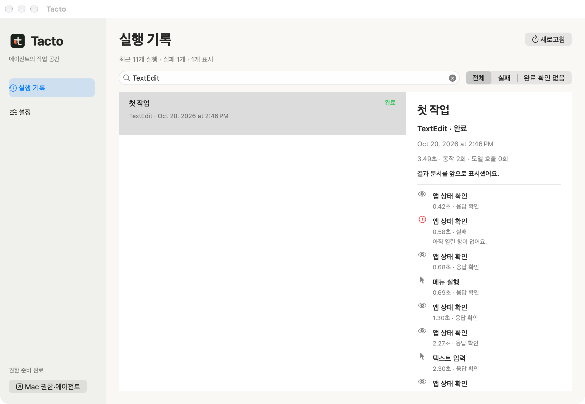

**English** · [한국어](README.ko.md)

<div align="center">


### Let your agent use your apps. Save the steps. Run them again.

**Tacto lets agents operate browsers and Mac apps on your behalf.**<br>
Turn clicks, typing, and checks into a reusable **Flow**.<br>
Replay it with new inputs. Bring the agent back when judgment is needed.<br>
**See the apps your agent accessed, the actions it took, and their outcomes in Tacto.**

[](docs/installation.md)
[](skill/SKILL.md)
[](#getting-started)

[Release candidate](https://github.com/Open330/tacto/releases/tag/v1.0.0-rc.7) · [How it works](#how-it-works) · [Benchmarks](#benchmarks) · [Documentation](#documentation)

</div>

## See it work in real apps

[](sites/tacto/dist/assets/demos/browser-wikipedia.mp4)

An animated preview from an actual recorded run. Click for the full MP4. GitHub's accessibility settings can disable animated-image autoplay.

**Ten recorded scenarios: eight real apps or websites, plus two public test environments.**

| App or site | Task and observed result | Recording |
| :--- | :--- | :--- |
| TextEdit | Write workshop notes; separately verify saved disk contents against the document | [10 sec](sites/tacto/dist/assets/demos/native-textedit.mp4) |
| Finder | Sort five files by kind, then by name | [8 sec](sites/tacto/dist/assets/demos/native-finder.mp4) |
| Google Translate | Enter a synthetic English example; separately check Korean output | [7 sec](sites/tacto/dist/assets/demos/browser-translate.mp4) |
| GitHub | Filter open bugs and sort by comment count | [9 sec](sites/tacto/dist/assets/demos/browser-github.mp4) |
| UnitConverters.net | Convert 3.5 m to 11.482939633 ft; compare with a separate calculation | [9 sec](sites/tacto/dist/assets/demos/browser-units.mp4) |
| Markdown Live Preview | Edit the opening section; check heading, list, and bold text | [18 sec](sites/tacto/dist/assets/demos/browser-markdown.mp4) |
| Wikipedia | Search Seoul and navigate to History | [14 sec](sites/tacto/dist/assets/demos/browser-wikipedia.mp4) |
| Mac Calculator | Replay the same Flow with different inputs; verify 15 and 12 | [14 sec](sites/tacto/dist/assets/demos/calculator-guided.mp4) |

<a href="sites/tacto/dist/assets/demos/native-textedit.mp4"></a>
<a href="sites/tacto/dist/assets/demos/native-finder.mp4"></a>

Also available: [product lookup](sites/tacto/dist/assets/demos/browser-shopping.mp4) and [form filling](sites/tacto/dist/assets/demos/browser-form.mp4) in public test environments. No purchase or registration was submitted.

Browser demos use **Python BrowserDriver + Flow in a separate Chromium instance**, rather than your existing Chrome or Safari tabs. TextEdit stopped when save evidence was insufficient; a separate Save verification then passed. Google Translate's output check is separate from proof of input delivery. The Markdown demo edits only the opening section and leaves other sample content intact.

Recordings include illustrative pointers and capture delays. They show authored Flows executing, not natural-language authoring, and are not speed or token benchmarks. Not every demo completed without intervention. [Conditions, results, and limits](docs/tacto-everyday-examples-2026-10-15.md).

Same-window [drag gestures](docs/native-drag.md) are supported by the signed macOS helper: sliders, text selection and canvas paths, with receiving tests in AppKit and TextEdit. Cross-app file drops are outside this route.

```sh
tacto capture <bundle-id> --helper --window 'Exact title' --output window.png
tacto drag <bundle-id> --helper --window 'Exact title' --from 20 80 --to 220 80
```

Apps that react to the real cursor (hover effects, a character that avoids it) can be exercised with `tacto hover`: it moves the cursor into the observed window without pressing a button, optionally captures the window while the cursor is there, and puts the cursor back. Moving the mouse yourself stops it. [Hover guide](skill/references/hover.md).

```sh
tacto hover <bundle-id> --helper --to 120 80 --hold 1 --capture during.png
```

## Know what your agent did

**Delegate the work. Inspect the activity.** Tacto's in-app history shows accesses
made through Tacto: the target app, operation, outcome and elapsed time. Search
runs, filter failures or unconfirmed completion, and follow each operation in a
timeline without opening a log directory.



Records stay on this Mac. Settings control automatic logging and 7/30/90-day
retention. Screen content, input values, prompts and internal agent reasoning
are excluded. [Activity history and settings](docs/access-logging.md).

<a id="how-it-works"></a>

## Make it once. Use it again.

```text
First time    Claude / Codex → observe the app → author and save a Flow
Next time     saved Flow + new inputs → Tacto executes and checks results
Repeat        same Flow + different inputs → Tacto executes and checks results
```

This is **computer use**: agents read app interfaces, click controls, and enter information for you. Tacto stores the procedure so the model does not have to reason through every routine step again.

| Author once | Replay with new inputs | Intervene when needed |
| :--- | :--- | :--- |
| Create a Flow with Claude or Codex | Resolve targets from fresh observations and check outcomes | Use a model for judgment or supported repairs |
| Model-independent execution format | **Zero model calls during normal deterministic replay** | Supported repair resumes at the affected step |

Authoring, judgment, and repair still cost model tokens. Automatic selector repair currently belongs to the **development checkout's Codex provider**; it is not included in the packaged release candidate.

<details>
<summary>What if the interface changes or completion is uncertain?</summary>

The development repair path passes only relevant candidates for supported static-selector failures. It resumes after verified checkpoints without blindly resending actions that may already have completed. It does not recover every UI change or crash. [Repair scope](docs/tacto-auto-repair-2026-10-14.md).

Native execution uses the existing Tacto menu bar icon for task status and **현재 작업 중단**; no extra helper icon appears. Press Esc to stop. In **설정**, turn off **작업 중 배너 표시** to hide the upper-right task banner starting with the next task.

</details>

## Reuse in a dedicated test app

[](sites/tacto/dist/assets/demos/workflow-guided.mp4)

The same 11-step Flow ran five times with different inputs in our own macOS test app, producing 89, 34, 62, 79, and 108, with one completion per job. Pointers and click effects were added for explanation; they are not recordings of system cursor movement.

[17-second walkthrough](sites/tacto/dist/assets/demos/workflow-guided.mp4) · [Unannotated recording](sites/tacto/dist/assets/demos/workflow-replay.mp4) · [Capture conditions](docs/tacto-recorded-demos-2026-10-15.md)

A separate development test completed ten jobs with zero replay-time model calls. Another repaired two changed buttons in one job using two model calls. These are dedicated test-app results, not a reliability guarantee for every business app. [Complex scenarios](docs/tacto-complex-scenarios-2026-10-14.md) · [TextEdit comparison](docs/benchmark-records.md#정확한-textedit-저장-상태의-실제-비교).

<a id="getting-started"></a>

## Get started

**1.0.0-rc.7 release candidate for Apple Silicon Macs on macOS 27.0.1.**

[Release candidate](https://github.com/Open330/tacto/releases/tag/v1.0.0-rc.7). Both **Tacto.app and the DMG passed Developer ID signing, Apple notarization, ticket validation, and Gatekeeper checks**. Download the DMG, drag `Tacto.app` into `Applications`, and open it to follow setup instructions. You do not need your own signing certificate for this packaged app. Version 1.0.0-rc.7 settles focus after foreground clicks and pointer location after hover, reduces repeated secondary-action queries, and offers a document-scoped session with its minimal guide. It retains first-task recovery and concise failure diagnostics without blanket hand-off instructions. This candidate requires fresh qualification. Optional faster startup keeps the helper ready between commands. It is off by default; enable it in settings when needed. One persistent menu shows settings and task status, and task banners remain optional. Browse operation timelines and configure logging and retention in the app. Grant two permissions on first run: **Tacto Helper** (app control) and **Tacto** (screen recording).

This is a **release candidate, not yet the approved stable release**. Stable qualification still needs a person-run fresh install, three permission revocation/regrant cycles and a limited beta ([guide](docs/beta-participant-guide.md)).

After setup, **Start first task** detects Claude Code or Codex and opens a fresh CLI conversation with one fixed Tacto command. The command launches TextEdit if needed, creates a new document and verifies its welcome text without an internal model call. The agent CLI may still ask for its normal trust or login confirmation.

Tacto runs in the menu bar without a Dock icon. Close the settings window to leave it in the background; use the menu bar icon to reopen settings or quit.

Installation, permissions, Claude/Codex connection and upgrades were verified on three Macs; on a second Mac, fresh Claude Code and Codex conversations completed a first Finder task. Other macOS versions, a person-run fresh install and the beta remain unverified. Windows and Intel Mac builds are not provided. The bundled onboarding UI and detailed guides are currently primarily Korean; this README is available in both languages.

Under the previous development signature, Finder and Safari completed 40 tasks. The first 20 TextEdit saves required the user to bring the app forward; all 20 retries then passed. Those initial failures remain in the record. These results are not unattended 60/60 success or approval of the newly signed DMG. [Release evidence and remaining checks](docs/release-readiness.md) · [Installation details](docs/installation.md).

### Build from source

Requires Python 3.11+, [uv](https://docs.astral.sh/uv/), Xcode Command Line Tools, and an Apple-issued code-signing certificate. The launcher and helper must be signed by the same team.

```sh
git clone https://github.com/Open330/tacto.git
cd tacto
uv sync
./build.sh
./skill/install.sh
~/.local/bin/tacto doctor
```

Follow `doctor` and the app’s “permission holder” label to grant macOS permissions to **Tacto Helper**. Then ask Claude or Codex:

> Use the Tacto skill to calculate 12 × 34 in Calculator and verify the result.<br>
> Save it as a parameterized Flow so I can run it again with different inputs.

Replay a saved Flow:

```sh
~/.local/bin/tacto run flow.json --helper
```

[Agent skill](skill/SKILL.md) · [Flow authoring guide](docs/recipes.md)

<details>
<summary>Installation notes and development-only commands</summary>

If your agent cannot find the skill, restart its session and check `./skill/install.sh --check`. The Python distribution is `tacto-runtime`; the canonical Python import is `tacto`. The Python wheel alone does not supply the signed native launcher/helper. The permission holder is **Tacto Helper** (`helper/Tacto Helper.app/Contents/MacOS/TactoHelper`) and the launcher is `launcher/tacto`; bundle identifiers and signing requirements use `ai.callabo.tacto.*`.

> **Python namespace conflict.** The top-level import `tacto` is also used by an unrelated PyPI package (a tactile-sensor simulator). Install this project's distribution, `tacto-runtime`, in its own environment, and never `pip install tacto` for Tacto. Installing both into one environment can overwrite each other's files.

These commands belong to the development checkout, not the main-branch release:

```sh
~/.local/bin/tacto batch template.json --helper < jobs.jsonl
~/.local/bin/tacto batch template.json --helper --auto-repair codex < jobs.jsonl
```

</details>

<a id="benchmarks"></a>

## Less repeated reasoning

**A development-version comparison observed 53.5% fewer total input tokens with Tacto than Sky.** Three independent fresh-conversation pairs matched the requested model, reasoning effort, and initial state of the test app.

| Metric | Tacto | Sky |
| :--- | ---: | ---: |
| Successful tasks | 3/3 | 3/3 |
| Total input tokens | **201,447** | 433,312 |
| Mean time | **42.10 sec** | 46.17 sec |

This is a small sample. Tacto was slower in one case; it is not universally faster. [Full methodology and results](docs/tacto-matched-comparison-2026-10-14.md).

<details>
<summary>Cache, output, and repeated-Flow results</summary>

2026-10-14 · Codex CLI 0.161.0 · requested model gpt-6.1-sol · medium. Includes initial authoring, execution, and the final response; excludes test setup. Actual serving model, server cache behavior, and billing were not verified.

- Input excluding cache reads: Tacto 22,119 / Sky 50,592 (**56.3% reduction**).
- Output: Tacto 1,605 / Sky 1,604.
- Total time: **8.8% reduction**. This was not a ten-replay comparison.
- Separate 11-step test-app scenarios: **13/13 normal completions**, **5/5 expected stops**, two button repairs in one job.
- Ten normal repeats in that separate test used **zero model calls**.

[Complex scenario results](docs/tacto-complex-scenarios-2026-10-14.md)

</details>

## Explore the onboarding site

The [landing page](https://open330.github.io/tacto/) ([source](sites/tacto/README.md)) introduces replay, repair, and stopping. Its interactive walkthrough does not execute real apps or models.

```sh
python3 sites/tacto/serve.py
```

Open `http://127.0.0.1:8787`.

<a id="documentation"></a>

Optional macOS **fast startup** keeps the signed helper warm between commands. Enable it in Tacto Settings (off by default, idle timeout 1–10 minutes), or use `TACTO_HELPER_MODE=warm`; `per_command` overrides it off. Concurrent commands wait up to 10 seconds before `helper_busy`. [Details and measured scope](docs/helper-execution.md).

## Documentation

Detailed guides are primarily Korean, with code examples and some English references.

[Installation](docs/installation.md) · [Windows (experimental)](docs/windows.md) · [Flows](docs/recipes.md) · [API](docs/api.md) · [Capabilities](docs/capabilities.md) · [Agent skill](skill/SKILL.md)

<details>
<summary>CLI reference</summary>

Available on the main branch:

| Purpose | Commands |
| :--- | :--- |
| Diagnose setup | `tacto doctor` |
| Observe apps and controls | `tacto apps`, `tacto observe`, `tacto menu-state` |
| Execute requests and Flows | `tacto do`, `tacto run`, `tacto replay` |
| Compile and parameterize | `tacto compile`, `tacto parameterize` |
| Manage Flows and candidates | `tacto list`, `tacto show`, `tacto candidates`, `tacto promote` |
| Evaluate | `tacto eval` |

Development-only commands, absent from main:

| Purpose | Commands |
| :--- | :--- |
| Batch, session, repair | `tacto batch`, `tacto session`, `tacto repair` |
| Document attachments | `tacto document-attachments` |
| Browser file registration | `tacto web-upload` |
| Experimental VRoid diagnostics | `tacto vroid-focus`, `tacto vroid-drag` — separate build with `TACTO_ENABLE_EXPERIMENTAL_FOREGROUND=1`; excluded from the default build |

Check `tacto --help` for your checkout. Use the signed launcher for native work and `--helper` where required.

</details>

<details>
<summary>All guides and validation records</summary>

- [GUI, branding, and independent review](docs/tacto-gui-review-2026-10-17.md)
- [tacto visual identity](docs/tacto-visual-identity.md)
- [tacto landing engineering 2026 10 15](docs/tacto-landing-engineering-2026-10-15.md)
- [tacto recorded demos 2026 10 15](docs/tacto-recorded-demos-2026-10-15.md)
- [tacto everyday examples 2026 10 15](docs/tacto-everyday-examples-2026-10-15.md)
- [tacto browser examples 2026 10 15](docs/tacto-browser-examples-2026-10-15.md)
- [release readiness](docs/release-readiness.md)
- [Beta participant guide](docs/beta-participant-guide.md)
- [First-run quality review](docs/tacto-quality-review-2026-10-19.md)
- [tacto native release fixes 2026 10 16](docs/tacto-native-release-fixes-2026-10-16.md)
- [tacto peer review 2026 10 16](docs/tacto-peer-review-2026-10-16.md)
- [tacto branding](docs/tacto-branding.md)
- [api](docs/api.md)
- [artifact receipts](docs/artifact-receipts.md)
- [benchmark records](docs/benchmark-records.md)
- [capabilities](docs/capabilities.md)
- [claude adapter](docs/claude-adapter.md)
- [completion plan](docs/completion-plan.md)
- [context paging](docs/context-paging.md)
- [delivery evidence](docs/delivery-evidence.md)
- [evaluation](docs/evaluation.md)
- [input observation](docs/input-observation.md)
- [permission onboarding](docs/permission-onboarding.md)
- [installation](docs/installation.md)
- [Automatic access records](docs/access-logging.md)
- [menu discovery](docs/menu-discovery.md)
- [model deadlines](docs/model-deadlines.md)
- [native visual](docs/native-visual.md)
- [native window input](docs/native-window-input.md)
- [Tacto automatic repair — scope and limits](docs/tacto-auto-repair-2026-10-14.md)
- [Tacto complex scenario validation](docs/tacto-complex-scenarios-2026-10-14.md)
- [Tacto and Sky matched comparison](docs/tacto-matched-comparison-2026-10-14.md)
- [provider envelope](docs/provider-envelope.md)
- [recipes](docs/recipes.md)
- [rtf receipts](docs/rtf-receipts.md)
- [save directory observation](docs/save-directory-observation.md)
- [textedit save](docs/textedit-save.md)
- [visual](docs/visual.md)

</details>

---

**Tacto** · Local execution. Reusable computer use.<br>
Release candidate · [MIT License](LICENSE)


<details>
<summary>Runtime updates and validation</summary>

- [dispatch-journal](docs/dispatch-journal.md)
- [journal-reconciliation](docs/journal-reconciliation.md)
- [menu-readiness](docs/menu-readiness.md)
- [tacto-attended-operation-design](docs/tacto-attended-operation-design.md)
- [tacto-authoring-literal-validation](docs/tacto-authoring-literal-validation.md)
- [tacto-capture-continuation-validation](docs/tacto-capture-continuation-validation.md)
- [tacto-latency-profile-20261019](docs/tacto-latency-profile-20261019.md)
- [tacto-native-matched-validation-20261019](docs/tacto-native-matched-validation-20261019.md)
- [tacto-native-resumption-validation](docs/tacto-native-resumption-validation.md)
- [tacto-provider-paging-validation](docs/tacto-provider-paging-validation.md)
- [tacto-textedit-saved-state-validation](docs/tacto-textedit-saved-state-validation.md)
- [window-preparation-diagnostics](docs/window-preparation-diagnostics.md)

</details>

[Preview 3 runtime update](docs/runtime-update-2026-10-19.md)
