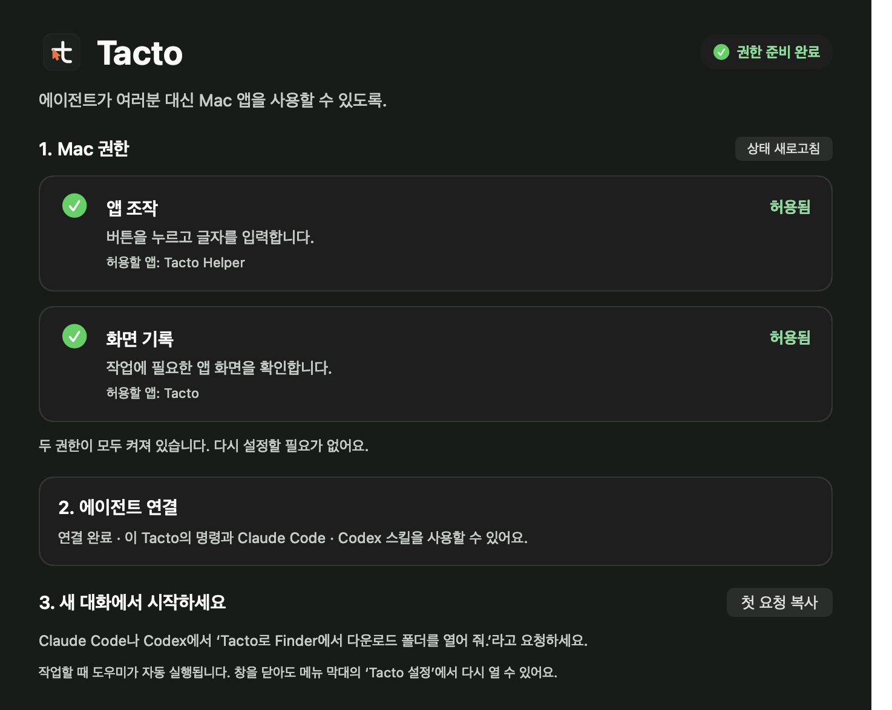
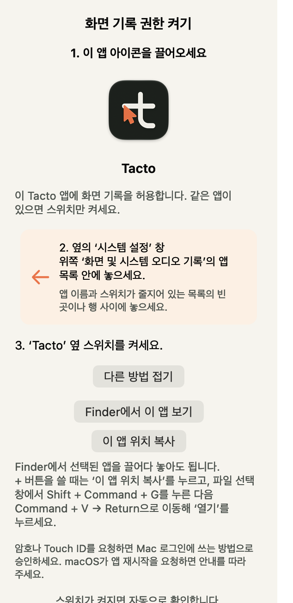

# Tacto GUI와 이전 브랜딩 재검토 — 2026-10-17

Claude peer가 코드와 AppKit 렌더링을 독립적으로 검토했습니다. 첫 검토에서
중요도 P1 두 건, P2 다섯 건과 시각적 개선을 지적했고, 수정 후 재검토했습니다.
이 문서는 이번 변경의 범위이며 모든 앱 호환성이나 출시 기준 통과를 뜻하지 않습니다.

## 수정한 사용자 경험

- 텍스트 높이가 압축되지 않도록 하고, 권한 카드의 안쪽 여백·본문 간격을 확보했습니다.
- 밝은·어두운 테마에 맞춰 본문·완료 상태의 대비와 카드 테두리를 정리했습니다.
- 완료를 흐린 비활성 버튼으로 표시하지 않고 ‘허용됨’으로 읽을 수 있게 했습니다.
- 메인 창과 권한 패널은 넘치는 내용에만 스크롤바를 표시합니다.
- 패널 도움말을 펼치거나 위치를 복사한 뒤에도 창을 화면 안에 두고 다시 배치합니다.
- ‘권한 확인 실패’를 ‘확인 중’과 구분하고 실제 ‘상태 새로고침’ 버튼을 안내합니다.
- 연결할 수 없는 이유를 설명하고, 기본 화면에서 별도 설치 경로에 관한 설명을 숨깁니다.
- 권한 안내의 드래그·놓기·스위치 켜기를 세 단계로 나누고, 목록 위치 힌트를 분리했습니다.
- doctor는 소스 설치의 helper와 독립 앱의 바깥 화면 기록 주체를 구분합니다.

아래는 AppKit에서 실제 UI를 렌더링한 **상태 fixture**입니다. ‘허용됨’·‘연결 완료’는
화면 검증을 위한 입력값이며 새 서명 후보의 실제 사용자 권한을 인증하는 증거가 아닙니다.

## 이름과 아이콘

- helper의 지역화된 표시 이름을 **Tacto Helper**로 제공합니다. Finder·Foundation에서
  실제 이름을 읽는 검사와 일본어 프로세스의 영어 fallback을 확인했습니다.
- helper 번들은 `Tacto Helper.app`이며, en/ko `InfoPlist.strings`가 사용자에게 보여줄
  Tacto 이름을 제공합니다.
- GUI와 doctor는 설치된 앱의 실제 이름을 안내합니다. 설정 목록의 실제 행은 사람이
  확인해야 하며 검증 완료로 세지 않습니다.
- 실행 중 메뉴·권한 오류·런처 오류의 제품 표기를 Tacto로 통일했습니다.
- 확정된 포인터 t 로고·앱 아이콘·웹 복사본을 같은 생성기 출력으로 맞췄습니다.
  이전 Git 이력은 병합하지 않고 필요한 자산 변경만 새 이력에 적용했습니다.
- 당시 `nlc` Python 모듈·명령 별칭·Flow 경로·환경 변수와 `ai.callabo.nlc.*` 서명 식별자는
  호환성 때문에 유지합니다. 과거 벤치마크의 원래 이름과 수치도 바꾸지 않습니다.

## 확인한 범위와 남은 배포 작업

- 관련 자동 검사 127개: 실패 0건, 서명 정책의 별도 opt-in 검사 1개 제외.
- AppKit 상태·테마 조합 14개: 텍스트 높이, 패널의 700/800/900pt 화면 경계,
  내용 초과에 따른 스크롤바 표시 검사 통과.
- helper·launcher·GUI 컴파일, helper 번들 서명 검증. 이전 Developer ID 후보와
  helper의 designated requirement가 같음을 비교했습니다. 실제 TCC 유지의 대체 증거는 아닙니다.
- 웹 검사 80/80 통과. 이번 실행에는 별도 axe 파일을 제공하지 않았습니다.
- 자산 생성기의 `--check` 통과. 별도 서명 미리보기 앱을 만들었으며 기존 설치는 교체하지 않습니다.

**게시된 Preview 1 DMG는 이전 버전입니다.** 이번 UI·브랜딩 수정이 들어간 후보는
새로 서명·공증하고 후보별 검증을 마친 뒤 별도 Release로 제공해야 합니다.

후속 namespace 이전의 현재 경로·호환 범위는 [브랜딩 전환 안내](tacto-branding.md)를 확인하세요.
