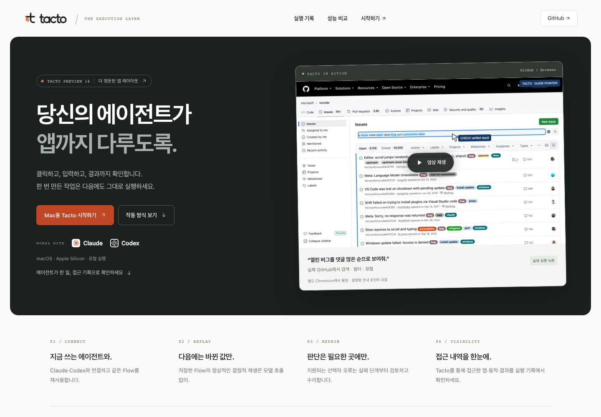

# Tacto onboarding



Claude·Codex가 만든 computer-use Flow를 재사용하는 Tacto의 온보딩 랜딩페이지입니다.
한국어 제품 설명과 영어 브랜드 문구, 반응형 레이아웃, 실행 예시, 시작 안내를 제공합니다.

첫 화면은 핵심 소개와 실제 GitHub 실행 영상을 나란히 배치합니다. 차콜·화이트와
주황색 강조색을 사용하며, 작업 방식 요약·업무 시나리오·실제 앱 사례·측정 결과·
Preview 13 앱 화면·설치 안내로 이어집니다. 사례 카드의 자세한 동작과 검증 범위는
펼쳐 읽을 수 있습니다. 앱 화면은 실제 설치본에서 캡처했으며 사용자 입력 내용은
포함하지 않습니다. 첫 화면과 시나리오의 GitHub 영상은 같은 녹화입니다.

성능 비교는 Tacto와 OAI/Sky의 2026-10-14 독립 새 대화 3쌍을 막대그래프와
공개 비교표로 표시합니다. 전체 입력·캐시 읽기 제외 입력·출력·평균 시간·성공을
나란히 제시하며, 원본은 `dist/assets/benchmark-summary.json`과
[측정 조건 기록](../../docs/tacto-matched-comparison-2026-10-14.md)입니다.
최초 작성·실행 비교이며 Preview 13 재측정이나 10회 재사용 비교가 아님을 표시합니다.

2026-10-20 시각 개편: 브라우저 검사 90/90 통과(영상 13개 요소의 재생·탐색,
캐러셀, 필터, 복사, 키보드, 모바일, JavaScript 없는 상태 포함). axe-core의
데스크톱·상세 펼침·모바일 검사에서 위반이 없었습니다. 자동 검사가 수동 접근성
검토 전체를 대신하지는 않습니다.

주요 업무 영역은 주간 이슈 점검·월말 증빙 정리·고객 문의 검토·백오피스 반복 입력의
시나리오 4개를 제시합니다. 입력 자료, 앱 간 단계, 기대 결과와 재사용 조건을 보여줍니다.
이는 전체 실행이 검증된 템플릿이 아닌 **업무 설계 예시**이며, 관련 녹화가 확인한 일부 조작과
아직 검증하지 않은 작업을 각 시나리오에 함께 명시합니다. Selenium 폼은 공개 테스트로 표시합니다.
넓은 화면에서는 12초마다 시나리오와 표지만 순환하며 영상은 직접 재생합니다.
좁은 화면에서는 직접 선택하도록 자동 넘김을 끕니다. 마우스를 올리면 일시 정지하고,
키보드 포커스·사례 선택·영상 재생 시 자동 넘김을 멈춥니다. 동작 줄이기 설정에서는 자동 순환하지 않습니다.
사례 영역에는 실제 앱·웹 8개와 공개 테스트 2개의 영상 및 종류별 필터를 제공합니다.
자체 앱의 반복 재사용 영상은 별도 접힌 검증 영역에 둡니다.
모든 영상은 실제 실행에 안내 포인터를 포함하며, 자동 재생 없이 재생할 때 로드합니다.

브라우저 예제는 Python API가 여는 별도 Chromium 세션이며, 개인 Chrome·Safari 탭에
연결하지 않습니다. 공개 사이트 Wikipedia와 공개 테스트 사이트 Books to Scrape·Selenium을
구분해 표시하고, Selenium 폼은 제출하지 않습니다.

[브라우저 예제·재현 방법](../../docs/tacto-browser-examples-2026-10-15.md) ·
[Mac 앱 촬영 조건](../../docs/tacto-recorded-demos-2026-10-15.md)

[확장한 일상 작업 10개·검증 범위](../../docs/tacto-everyday-examples-2026-10-15.md)

## 로컬 미리보기

저장소 루트에서:

```sh
python3 sites/tacto/serve.py
```

브라우저에서 http://127.0.0.1:8787 을 엽니다. 종료는 Ctrl+C입니다.
빌드 단계나 npm 의존성이 없습니다. 로컬 서버에는 macOS/Linux의 Python 3.9 이상이 필요합니다.

다른 기기에서 보려면 서버를 실행하는 컴퓨터의 LAN 주소를 지정합니다.

```sh
python3 sites/tacto/serve.py --host <LAN-IP> --port 8787
```

같은 네트워크에서 `http://<LAN-IP>:8787`로 접속합니다.
서버는 `dist/`의 정적 파일만 제공하며 폴더 목록·숨김 경로·심볼릭 링크는 제공하지 않습니다.
CSP·referrer·프레임·MIME 보호 헤더를 함께 보냅니다.
영상은 HTTP byte range로 탐색할 수 있습니다.
HTML·CSS·JS·SVG·JSON은 gzip을 협상하고, ETag가 같으면 본문 없이 304를 반환합니다.
파일 변경을 매번 재검증하므로 같은 이름의 새 로고나 스크립트가 오래 캐시되지 않습니다.
이 명령을 직접 실행한 경우 Ctrl+C로 종료합니다.

## 파일

- `dist/index.html`: 콘텐츠·측정 조건·온보딩·FAQ
- `dist/style.css`: 반응형 디자인·키보드 포커스·reduced motion
- `dist/app.js`: 설명용 실행 예시·에이전트 선택·명령 복사
- `dist/assets/benchmark-summary.json`: 2026-10-14 동일 조건 비교의 공개 요약
- `dist/assets/`: 외부 폰트 없이 그린 SVG 로고·워드마크·배너·아이콘
- `serve.py`: 정적 파일 전용 LAN 서버
- `qa.py`: Playwright 기반 키보드·복사·반응형·JavaScript 없는 화면 검사

실행 예시 버튼은 실제 앱·명령·모델을 호출하지 않습니다.
폼, 계정, 분석 추적, 서버 API는 없습니다. 폰트·스크립트·이미지는 외부 CDN에 요청하지 않으며 시스템 폰트와 같은 사이트의 파일만 사용합니다.
방문자의 값을 저장·전송하는 기능은 없습니다. 정적 호스팅 사업자는 별도로 접속 로그를 남길 수 있습니다.
페이지는 CSP로 외부 연결을 차단하고 외부 링크에 referrer를 보내지 않습니다.

## 정적 호스팅

`dist/`의 내용을 정적 호스트의 공개 루트에 그대로 올리면 됩니다.
상대 경로를 사용하므로 하위 경로에서도 제공합니다. 별도의 rewrite 설정은 필요하지 않습니다.
공개 배포 시 실제 URL에 맞춰 canonical·Open Graph URL/공유 이미지를 설정할 수 있습니다.

현재 저장소에 배포 설정이나 공개 사이트 URL을 만들지는 않았습니다.
설치 안내는 GitHub의 문서를 연결하고, 아직 게시되지 않은 측정 기록은 페이지 내 조건과 JSON 요약으로 제공합니다.

이전 이름·명령·권한의 호환성은 [전환 안내](../../docs/tacto-branding.md)를 참고하세요.


## 브라우저 회귀 검사

테스트 환경에 Playwright와 Chromium을 준비한 뒤 서버를 실행하고 검사합니다.
Playwright는 QA 도구이며 페이지가 내려받는 의존성이 아닙니다.

```sh
python3 sites/tacto/qa.py --url http://127.0.0.1:8787 --output /tmp/tacto-page-qa
```

이미 준비한 axe-core의 `axe.min.js`가 있으면 `--axe /path/to/axe.min.js`로
자동 접근성 검사를 추가합니다. 파일을 제공하지 않으면 axe 검사는 생략합니다.
검사는 임시 브라우저를 사용하며 개인 브라우저 프로필에 연결하지 않습니다.
결과 JSON과 화면 캡처를 출력 폴더에 저장합니다. 자동 검사 통과가 모든 접근성
요구사항의 수동 검토를 대신하지는 않습니다.

## 포인터 안내 영상 다시 만들기

개발 환경에 `ffmpeg`와 `rsvg-convert`가 있으면 저장소 루트에서 실행합니다.
페이지 사용자는 이 도구를 설치할 필요가 없습니다.

```sh
python3 sites/tacto/annotate_recordings.py
```

`assets/demos/pointer-guide.json`의 대상 위치·동작 순서와 캡처 프레임 변화에
맞춰 안내 표시를 렌더링합니다. 표시 시각은 설명을 위한 재구성이며 실제
마우스 좌표·정밀한 입력 시각을 측정한 값이 아닙니다. 원본 파일은 유지합니다.

## 브라우저 예제 다시 촬영하기

프로젝트 Python 환경에 Playwright·Chromium과 ffmpeg를 준비한 뒤 실행합니다.
공개 사이트에 접속하므로 네트워크 연결이 필요합니다. 결과 폴더는 새 경로를 사용합니다.

```sh
python3 sites/tacto/record_browser_demos.py --output /tmp/tacto-new-browser-recording
```

`--scenario wikipedia`, `shopping`, `form`으로 한 예제만 선택할 수도 있습니다.
개인 프로필을 사용하지 않으며, 입력·클릭·선택은 Tacto Flow로 실행합니다.
촬영을 위한 안내 포인터와 동작 전후 대기 시간이 있으므로 실행 시간 벤치마크로 쓰지 않습니다.

## 사례 선택 근거

2026-10-18 검토: [OpenAI의 실제 사용 분석](https://openai.com/index/how-people-are-using-chatgpt/)은
실용적인 도움·정보 찾기·글쓰기가 대화의 약 4분의 3을 차지한다고 보고합니다.
[Anthropic의 사용 분석·설문](https://www.anthropic.com/research/economic-index-june-2026-report)은
응답자의 절반 이상이 지루한 업무의 자동화를 희망하며, Cowork에서 데이터·스프레드시트
작업의 자율 실행이 두드러진다고 보고합니다.
이는 화면 조작 작업의 선호도 순위나 Tacto 사용자의 수요 조사 결과는 아닙니다.

[Microsoft의 업무 실태 조사](https://www.microsoft.com/en-us/worklab/work-trend-index/breaking-down-infinite-workday/)는
앱 전환·메일·회의·알림이 업무에 겹쳐 들어오는 문제를 다룹니다. 이를 참고해 단순 문서 생성보다
여러 앱의 정보를 대조하고 반복 입력·검토하는 업무를 먼저 설명하기로 판단했습니다.
네 업무의 인기 순위를 직접 측정한 결과는 아닙니다. 관련 녹화는 기존 촬영본만 사용합니다.
추가 촬영 우선 후보는 메일 분류·답장 초안, 스프레드시트 정리·반복 보고서,
영수증·다운로드 파일 정리, 여러 사이트의 조건 비교입니다.
이 후보들은 현재 페이지에서 검증 완료한 기능이나 실제 녹화로 소개하지 않습니다.
